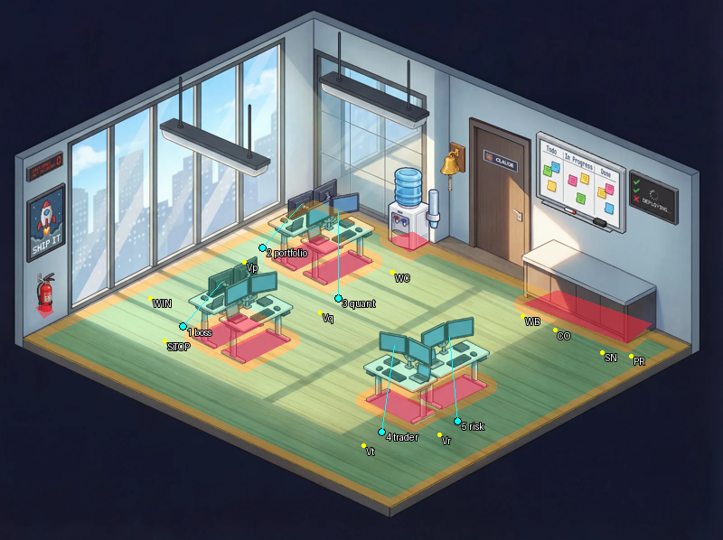
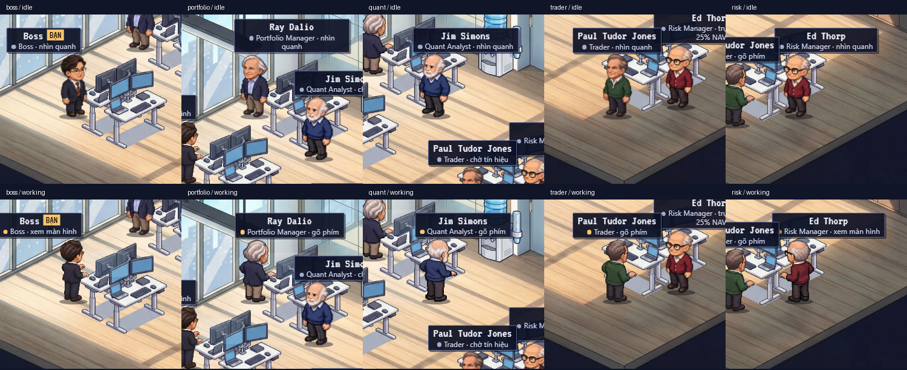

# Kiểm tra vị trí đứng và đường đi

## Phạm vi đã sửa

Mỗi nhân vật có một bàn riêng. Ray Dalio chuyển sang bàn phía sau, tách khỏi
cụm bàn Boss. Chỗ đứng nghỉ trùng với trạm làm việc; hướng làm việc tính từ
chân nhân vật tới tâm màn hình.

`tools/room-layout.json` lưu các footprint chân đồ vật đo từ ảnh lưới phóng to.
Build trừ 6 bàn, quầy/tủ, bình nước và bình chữa cháy khỏi đa giác sàn, chừa
khoảng đệm khoảng 0,6 ô. Một ô là 32 pixel trên ảnh phòng gốc 1600 × 1195.

Đồ thị sinh từ vùng sàn gồm 5.153 điểm và 19.335 cạnh. Mọi đường đi dùng A*,
kể cả Trader tới Boss, các cuộc trò chuyện và chuyến lấy bản in sau khớp lệnh.
Các đoạn rút gọn vẫn được lấy mẫu trong mask. Khi có người chắn đường, nhân
vật đợi và tìm đường lại; bước di chuyển được chia nhỏ để giữ khoảng cách tối
thiểu 0,8 ô. Các trạm khác được giữ trống để chủ bàn có thể quay về an toàn.



Màu đỏ: footprint đồ vật; vàng cam: vùng đệm; xanh lá: sàn đi được; điểm xanh
dương: trạm làm việc; điểm vàng: vị trí tương tác. Đã xem ảnh và xác nhận các
điểm đứng nằm ngoài chân đồ vật.

## Ảnh từng trạm



Đã xem cả 10 ảnh. Chân người không nằm trong chân bàn; Boss và Ray ở hai cụm
bàn khác nhau. Test kiểm tra vị trí trạm, hướng nhìn được tính từ tọa độ và
ít nhất hai frame gõ phím. Ảnh màn hình 400px cũng được kiểm tra.

## Kiểm thử

| Kiểm tra | Kết quả |
| --- | --- |
| Build Windows, UTF-8 và đầu ra LF ổn định | Qua |
| Toàn bộ điểm/cạnh nằm trên sàn; mọi điểm đến có đường tới | Qua |
| Năm bàn riêng, trạm cách nhau ít nhất 1,5 ô | Qua |
| Soak 120 giây, lấy mẫu mỗi 100 ms với tốc độ Nhanh | Qua |
| Luồng duyệt, bỏ qua, Block 50% và reset (`smoke`) | Qua |
| Hoạt cảnh, đặt chỗ trò chuyện, hủy hoạt cảnh (`ambient`) | Qua |
| Thời tiết/GOD (`v4`), chat (`v5`), animation (`v6`) | Qua |
| Cà phê, máy in và Ray lấy bản in sau khớp lệnh (`pantry`) | Qua |
| Mask trời và đèn hiện có (`v9`) | Qua |
| Đối chiếu Python: 12 kịch bản, 1.107 bước | 0 sai khác |

Trong soak đầu tiên, 1.197 mẫu được ghi; khoảng cách gần nhất giữa hai người
là 0,815 ô. Cả 5 người đều rời bàn rồi quay về. Không phát hiện chân nằm ngoài
sàn, trong đồ vật, hoặc chồng lên người khác. Soak có giao việc giữa một chuyến
đi, Trader trình đề xuất, duyệt lệnh, khớp nến kế, lấy bản in, reset và trò chuyện.
Lần xác minh cuối ghi 1.197 mẫu, khoảng cách gần nhất 0,884 ô, không lỗi và cả
5 người đều quay về trạm. Bản kết quả đã lưu tại `docs/navigation-soak.json`;
chạy lại test sẽ ghi `shots/navigation-soak.json`.

`src/logic.js` giữ nguyên. Bản `dist/quant-fun.html` khớp byte với bản standalone
dùng để kiểm thử và hoạt động từ `file://` không có yêu cầu mạng.

Các sửa chữa kiểm thử đi kèm: dùng tọa độ trạm từ dữ liệu thay cho số cũ; kiểm
tra cooldown bằng trạng thái routine thay vì khớp nhầm "xem màn hình"; quan sát
đủ bốn frame trên một đường đi dài; sửa số lượng prop pantry thành 4 prop + 2
biến thể; để test pantry/v9 trả mã lỗi khi assertion thất bại.

## Chạy lại

Theo bước cài đặt trong `README.md`, sau đó:

```powershell
npm.cmd run build
npm.cmd run test:all
npm.cmd run test:parity
```

Log chi tiết nằm trong `gen/test-*.log`; ảnh cận cảnh riêng từng người ở
`shots/station-<role>-idle.png` và `shots/station-<role>-working.png`.

Hạng mục ánh sáng ban đêm và ảnh phòng bỏ nắng trong `TODO-NEXT.md` vẫn là
các công việc tiếp theo; chúng nằm ngoài bản sửa vị trí/đường đi này.
